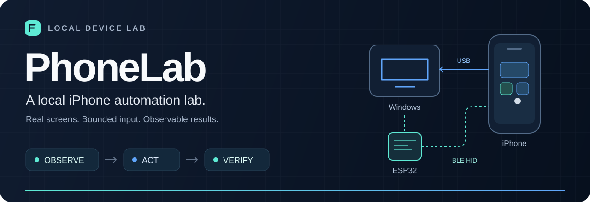
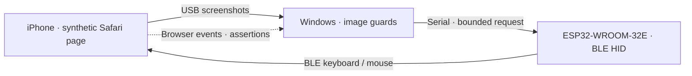

<p align="center">
  
</p>

<p align="center">
  <strong>English</strong> · <a href="README.zh-CN.md">简体中文</a><br>
  <a href="#how-it-works">Architecture</a> · <a href="#what-works-today">Status</a> · <a href="#run-locally">Quick start</a> · <a href="docs/PROGRESS.md">Progress</a>
</p>

PhoneLab is an experimental Windows lab for observing a real iPhone over USB and testing bounded ESP32 BLE keyboard/mouse input on a synthetic browser page. It connects **screen evidence, a constrained action, and an independently checked result**.

> **Experimental.** Real-device evidence comes from one iPhone 11 on iOS 17.5.1. General phone automation and broad compatibility are still open work.

> **Fresh text samples verified.** The keyboard repair passed a 35-action text/symbol/deletion batch on the lab phone. Broader scrolling and sustained input stability remain open. See [Progress](docs/PROGRESS.md).

## How it works

| Observe | Act | Verify |
| :--- | :--- | :--- |
| Capture real USB screenshots; locate the live page, pointer and target in the image. | Send an explicitly requested, bounded BLE HID action through an ESP32. | Compare screenshots and browser-reported events; preserve uncertain outcomes. |



Ordinary startup serves the local interface with the input backend **off**. USB capture is opt-in. Separate one-shot experiments require fresh screen evidence, exclusive input ownership, session checks and shared cancellation. The generic controller refuses input when the OS lock state is `UNKNOWN`; the synthetic-page experiment does not relabel it as unlocked.

## What works today

| Capability | Evidence / boundary |
| :--- | :--- |
| **USB observation** | Real 828 × 1792 screenshots on the lab phone. |
| **Image-guided click** | Small target samples, checked against trusted browser events and delayed real screenshots. Full 25-target acceptance remains open. |
| **Small vertical scroll** | A fresh 10-sample alternating batch passed: five in each direction, with matching image displacement and unchanged click counts. Broader scrolling remains unverified. |
| **Text / backspace** | The repaired firmware passed 35 actions covering uppercase, mixed case, spaces, digits, `!@#` and character-by-character deletion, with exact image/native-event checks. Earlier failed bursts remain recorded. |
| **Pointer drag** | Five historical complete samples and five fresh samples after the Safari compatibility fix on the repaired firmware passed image, native-event and visible-counter checks. A preparatory unheld move now synchronizes core state before press. |
| **Recovery** | One host-shutdown / board-USB recovery followed by a verified click. Three-round reconnect acceptance remains open. |
| **Host validation** | Automated guard, protocol, cancellation, export and vision tests. These do not establish device behavior. |
| **Still in progress** | Broader scrolling, sustained input stability and cross-device support. |

The [progress log](docs/PROGRESS.md) retains failed and unknown trials alongside successful samples. A firmware `executed` acknowledgement is transport evidence; it does not prove the intended iOS effect. Browser events also do not independently prove their hardware source.

## Run locally

**Host:** Windows, Python 3.13 and PowerShell 7. Windows OCR uses the system API through Windows PowerShell 5. USB capture additionally needs Apple drivers, a valid trust relationship and a private, confirmed target binding. Current identity checks are specific to the frozen lab model/OS; this is not a turnkey setup for arbitrary phones.

```powershell
py -3.13 -m venv .venv
.\.venv\Scripts\python.exe -m pip install -r requirements.lock.txt
$env:PHONELAB_DATA_ROOT = Join-Path $env:LOCALAPPDATA 'PhoneLab\data'
pwsh -NoProfile -File .\Start-PhoneLab.ps1
```

For faster CPU pointer-mask checks, optionally install the pinned headless
accelerator with `python -m pip install -r requirements-vision-fast.txt` inside
the virtual environment. It preserves the Pillow reference operations and
does not add a GUI or change the input guards.

The service binds to **loopback** by default; it does not enable the LAN proxy automatically. To explicitly request read-only USB capture:

```powershell
pwsh -NoProfile -File .\Start-PhoneLab.ps1 -CaptureUsb
```

Use `PHONELAB_PWSH` to select a local PowerShell executable. Non-secret paths can also go in the ignored `.phonelab-local.json` (`data_root`, `pwsh`, `python_source`); environment variables take precedence. Keep runtime data outside the repository.

**Request a stop:**

```powershell
.\.venv\Scripts\python.exe -m phonelab stop
```

This requests a runtime stop; it is not independent confirmation that the phone released every input. An uncertain action stops the trial and is never automatically replayed.

## Build & test

```powershell
# Build only — no upload, erase or serial connection
pwsh -NoProfile -File .\scripts\Build-Firmware.ps1

# Host checks — no real-device acceptance implied
.\.venv\Scripts\python.exe -m pytest -q
```

The WROOM-32 experimental firmware uses BLE HID over GATT and local serial JSON lines. It starts no Wi-Fi or TCP service. The retained S3 upstream target is separate. Firmware tooling is pinned by version and source digest.

## Lab boundaries

- **Preserve first.** Obtain and verify a complete board backup before separately authorizing any write. Actual backup restoration is still **untested**.
- **Frozen phone.** This lab preserves iOS 17.5.1; the workflow does not require a phone update, restore or jailbreak.
- **Fail closed.** Missing targets, stale frames, ambiguous geometry, changed sessions and cancellation stop the affected action. No automatic replay of uncertain input.
- **Private evidence stays local.** Screenshots, pairing records, tokens, identifiers, firmware dumps, backups and machine configuration are excluded from this public snapshot.

## License & attribution

Project-authored code is **GPL-3.0-or-later**. Retained MIT components and other dependencies keep their own terms. See [LICENSE](LICENSE) and [third-party notices](THIRD_PARTY_NOTICES.md).

For the current acceptance gaps and reproducible bounded experiment, see [Progress](docs/PROGRESS.md).
