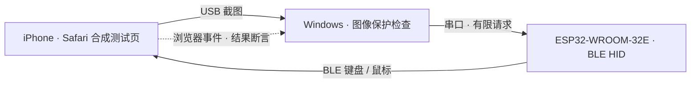

<p align="center">
  
</p>

<p align="center">
  <a href="README.md">English</a> · <strong>简体中文</strong><br>
  <a href="#工作方式">架构</a> · <a href="#当前能力">进展</a> · <a href="#本机运行">快速开始</a> · <a href="docs/PROGRESS.md">实验记录</a>
</p>

PhoneLab 是一个面向 Windows 的实验项目：通过 USB 观察真实 iPhone，用 ESP32 BLE 键盘和鼠标在合成浏览器页面上测试有限输入，将 **画面证据、受限动作和独立结果核验** 连成一条链路。

> **实验阶段。** 真机证据来自一台 iPhone 11 / iOS 17.5.1。通用手机自动化与广泛兼容性仍待完成。

## 工作方式

| 观察 | 执行 | 验证 |
| :--- | :--- | :--- |
| 获取真实 USB 截图，从图像定位当前页面、指针和目标。 | 经 ESP32 发送明确请求、范围受限的 BLE HID 动作。 | 交叉检查截图与浏览器报告事件，保留不确定结果。 |



普通启动只提供本机界面，输入后端保持 **关闭**；USB 采集需要显式启用。独立的单次实验要求新鲜真实画面、独占输入控制、会话检查与共享取消。通用控制器在系统锁状态为 `UNKNOWN` 时拒绝输入；合成页实验也不会把这个状态改标为已解锁。

## 当前能力

| 能力 | 已有证据与边界 |
| :--- | :--- |
| **USB 观察** | 实验手机的真实 828 × 1792 截图。 |
| **图像定位点击** | 少量目标已由可信浏览器事件与延迟真实截图交叉核验；完整 25 目标验收仍未完成。 |
| **小幅纵向滚动** | 新一轮 10 次交替滚动通过，正反方向各五次，截图位移一致且点击计数不变；更大范围滚动仍未验证。 |
| **中断恢复** | 一次电脑关机、开发板 USB 重连后完成核验点击；三轮重连验收仍未完成。 |
| **主机验证** | 自动检查图像保护、协议、取消、公开导出等行为；这些测试不等同于真机效果。 |
| **继续开发** | 真实文本输入、删除、拖动、持续输入稳定性与跨设备支持。 |

[进展记录](docs/PROGRESS.md) 同时保留成功、失败及未知试验。固件返回 `executed` 只证明协议链路接受请求，不证明 iOS 达成预期效果；浏览器事件也不能独立证明其硬件来源。

## 本机运行

**主机要求：** Windows、Python 3.13、PowerShell 7。OCR 通过 Windows PowerShell 5 调用系统 API。USB 采集还需要 Apple 驱动、有效信任关系和已确认的私密目标绑定。当前身份检查限定冻结实验机型与系统版本，不能直接用于任意手机。

```powershell
py -3.13 -m venv .venv
.\.venv\Scripts\python.exe -m pip install -r requirements.lock.txt
$env:PHONELAB_DATA_ROOT = Join-Path $env:LOCALAPPDATA 'PhoneLab\data'
pwsh -NoProfile -File .\Start-PhoneLab.ps1
```

服务默认只绑定 **本机回环地址**，不会自动开启 LAN 代理。明确请求只读 USB 截图：

```powershell
pwsh -NoProfile -File .\Start-PhoneLab.ps1 -CaptureUsb
```

可用 `PHONELAB_PWSH` 指定 PowerShell 程序。被忽略的 `.phonelab-local.json` 也可保存非秘密路径（`data_root`、`pwsh`、`python_source`），环境变量优先。运行数据应放在仓库之外。

**请求停止：**

```powershell
.\.venv\Scripts\python.exe -m phonelab stop
```

这会请求运行时停止，但不是手机已释放全部输入的独立证明。不确定的动作会终止当前试验，不会自动重发。

## 构建与测试

```powershell
# 仅构建：不上传、不擦除、不连接串口
pwsh -NoProfile -File .\scripts\Build-Firmware.ps1

# 主机检查：不代表真机验收
.\.venv\Scripts\python.exe -m pytest -q
```

WROOM-32 实验固件使用 BLE HID over GATT 与本机串口 JSON 行协议，不启动 Wi-Fi 或 TCP 服务。保留的 S3 上游目标是独立固件。构建工具受版本与源文件摘要约束。

## 实验边界

- **先保全原板。** 完整备份并核验后，仍需单独授权每次写入；真实备份恢复尚未测试。
- **冻结手机系统。** 本实验保留 iOS 17.5.1，流程不要求升级、恢复或越狱手机。
- **不确定即停止。** 目标缺失、画面过期、几何歧义、会话变化或取消时停止相应动作，不自动重发未知输入。
- **私密证据留在本机。** 截图、配对记录、令牌、身份标识、固件镜像、备份与机器配置不进入公开快照。

## 许可与致谢

项目自有代码采用 **GPL-3.0-or-later**；保留的 MIT 组件及其他依赖继续适用各自条款。详见 [LICENSE](LICENSE) 与 [第三方声明](THIRD_PARTY_NOTICES.md)。

完整验收缺口与受限实验复现方式见 [进展记录](docs/PROGRESS.md)。
